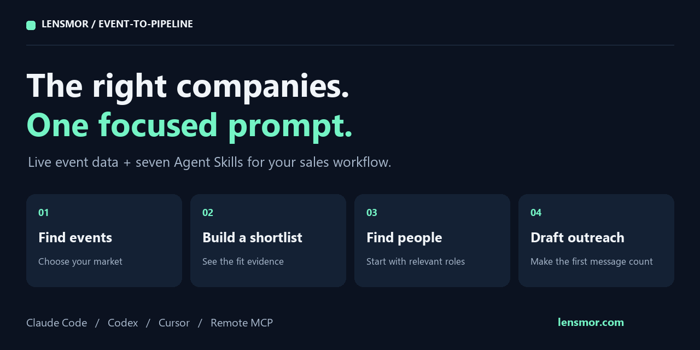
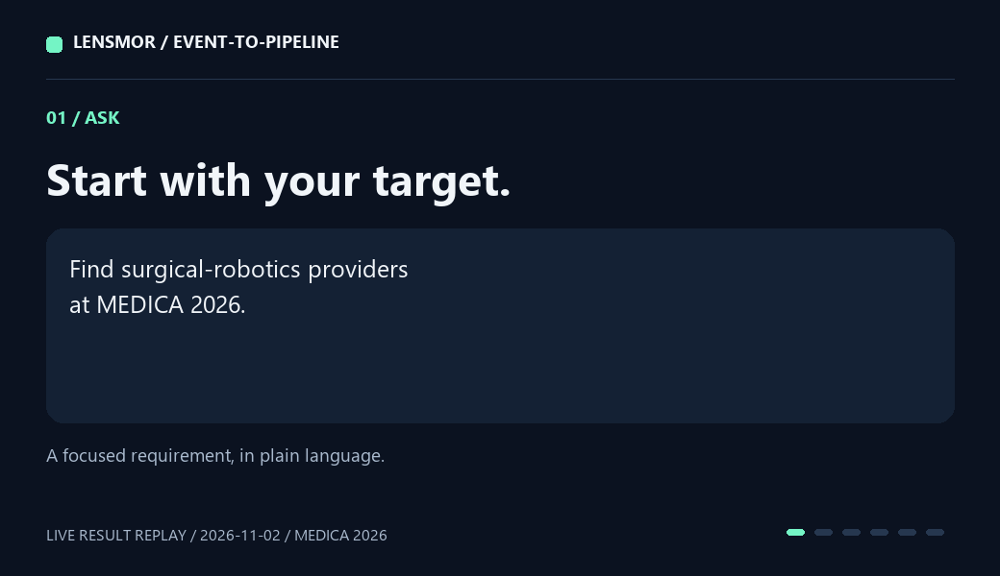

# Event-to-Pipeline

**Turn an exhibitor directory into a researched target list with one prompt.**

Find the right events, identify companies that fit your product, find relevant people, and draft a useful first message. Seven Agent Skills connect your AI client to Lensmor's live event and company data.



[](docs/CHANGELOG.md)
[](docs/exhibitor-export.md)
[](NOTICE.md)

[中文](README.zh-CN.md) · [Get access](#get-access) · [Quick start](#quick-start) · [Live example](examples/04-medica-live/README.md) · [MCP setup](integrations/mcp/README.md)

## See the result

```text
Use event-account-prioritizer to find surgical-robotics providers at
MEDICA 2026. Return a shortlist with evidence for each company's fit.
Use existing access and keep candidates that need review separate.
```



A MEDICA 2026 search turns a surgical-robotics brief into a selected account with supporting evidence. [Explore the company and research brief](examples/04-medica-live/README.md).

## Get access

1. **[Create a Lensmor account](https://app.lensmor.com/signup?utm_source=github&utm_medium=readme&utm_campaign=event-to-pipeline&utm_content=get-access).** Event search is free, with 2,000 starter credits and no credit card required. [Current plans](https://www.lensmor.com/pricing?utm_source=github&utm_medium=readme&utm_campaign=event-to-pipeline&utm_content=plans). Explore the preview results available to your account. Each response reports the accessible scope; full directories and contact fields follow your account's entitlements.
2. **Connect MCP** in [your client](integrations/mcp/README.md). The remote endpoint is `https://platform.lensmor.com/mcp`.
3. **For Python CSV exports**, create a REST API key in **Settings → API Keys** with a paid Lensmor subscription. Set it as `LENSMOR_API_KEY` in your local environment. [API key guide](https://api.lensmor.com/guides/quickstart?utm_source=github&utm_medium=readme&utm_campaign=event-to-pipeline&utm_content=rest-key).

MCP account access and REST API keys are configured separately. You can also try the [offline examples](examples/README.md) immediately or [open Lensmor Agent](https://app.lensmor.com/dashboard/agent?utm_source=github&utm_medium=readme&utm_campaign=event-to-pipeline&utm_content=agent) in your browser.

## Quick start

Choose one client and run the commands from the project where you want to use the Skills. The [Skills CLI](https://github.com/vercel-labs/skills) needs Node.js 22.20+.

### Claude Code

```bash
npx skills add LensmorOfficial/event-to-pipeline --skill '*' --agent claude-code --copy
claude mcp add --transport http lensmor https://platform.lensmor.com/mcp
```

Start Claude Code in that project, inspect the Lensmor connection with `/mcp`, and paste the prompt above.

### Codex

```bash
npx skills add LensmorOfficial/event-to-pipeline --skill '*' --agent codex --copy
```

Merge [this configuration](integrations/mcp/codex.config.example.toml) into your project's `.codex/config.toml`, trust the project, then run:

```bash
codex mcp login lensmor
```

The configuration selects the 15 research tools used by these Skills. Start Codex, use `/mcp` to inspect the connection, and paste the research prompt.

### Cursor and Claude Desktop

[Cursor setup](integrations/mcp/README.md#cursor) includes Skill installation and a copyable MCP configuration. [Claude Desktop setup](integrations/mcp/README.md#claude-desktop) connects the same remote service through a custom connector.

### Install with Python

With Python 3.11+, the bundled installer needs no pip packages. Clone or extract the source, then choose a separate target project:

```bash
git clone https://github.com/LensmorOfficial/event-to-pipeline.git
cd event-to-pipeline
python scripts/install_skills.py --destination ../my-project/.claude/skills --dry-run
python scripts/install_skills.py --destination ../my-project/.claude/skills
```

Use `.agents/skills` for Codex or `.cursor/skills` for Cursor. The installer copies resources and licenses and preserves existing Skills. [Full client guide](integrations/mcp/README.md).

## What you can do

| Start with | Skills | Take away |
| --- | --- | --- |
| Which events fit our market? | [research-events](skills/research-events/SKILL.md) + [event-fit-scorer](skills/event-fit-scorer/SKILL.md) | Event comparison with dates, audience evidence and fit reasons |
| Who should we meet at this show? | [research-exhibitors](skills/research-exhibitors/SKILL.md) + [event-account-prioritizer](skills/event-account-prioritizer/SKILL.md) | Target companies and evidence behind each selection |
| Which roles should we approach? | [research-people](skills/research-people/SKILL.md) + [event-buying-committee-mapper](skills/event-buying-committee-mapper/SKILL.md) | Relevant contacts with role and company context |
| What should we say? | [booth-invitation-writer](skills/booth-invitation-writer/SKILL.md) | Personalized invitation drafts for your review |

## Export exhibitor data

Try an offline export first:

```bash
python scripts/export_exhibitors.py --sample examples/exhibitor-export/sample.json --max-pages 2 --output exhibitors.csv
```

For live data, set `LENSMOR_API_KEY` and replace `EVENT_ID` with a confirmed event ID:

```bash
python scripts/export_exhibitors.py --event-id EVENT_ID --country Germany --max-pages 3 --output live-exhibitors.csv
```

The helper filters, paginates within your chosen limit, deduplicates by company ID and saves a CSV with a scope receipt. [Export reference](docs/exhibitor-export.md).

## Which Lensmor repository should I use?

| Repository | Best for | Data connection |
| --- | --- | --- |
| **Event-to-Pipeline** | Researching events, target accounts and people with live Lensmor data | Remote MCP; REST key for Python export |
| [trade-show-skills](https://github.com/LensmorOfficial/trade-show-skills) | Broader show planning: budgets, booth preparation, invitations and follow-up | Ten planning Skills work without a Lensmor API key; five data Skills use REST |
| [API-Doc](https://github.com/LensmorOfficial/API-Doc) | Building your own integration | REST API reference and examples |

## Contributing

[Changelog](docs/CHANGELOG.md) · [Contributing](docs/CONTRIBUTING.md) · [Download source](https://github.com/LensmorOfficial/event-to-pipeline/archive/refs/heads/main.zip)

Live data is provided by [Lensmor](https://www.lensmor.com/?utm_source=github&utm_medium=readme&utm_campaign=event-to-pipeline&utm_content=footer). Helpers and invitation drafting use MIT; the six research Skills use ISC. [Licensing and provenance](NOTICE.md).
