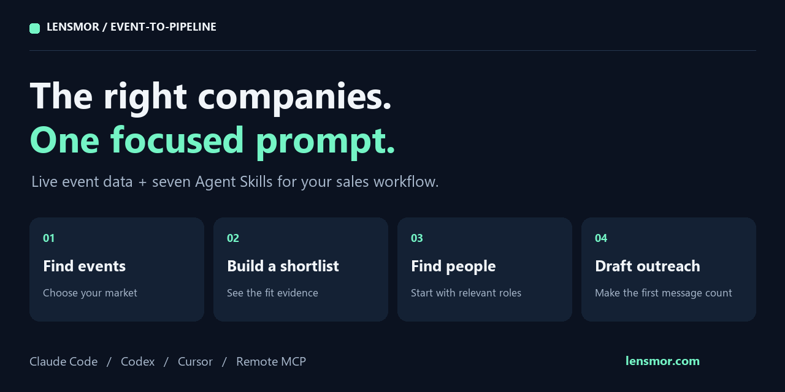
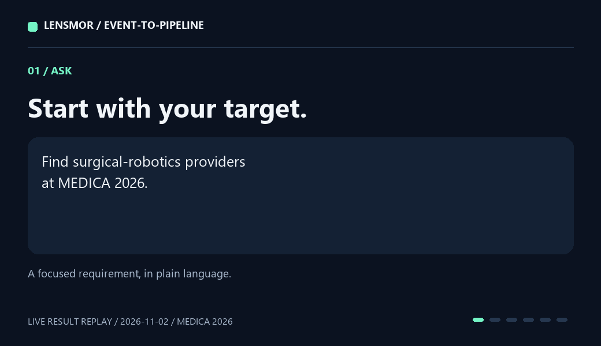

# Event-to-Pipeline

**展前选客户，从手动翻参展商名单，到用一个 prompt 拿到有依据的目标名单。**

找合适的展会、筛选符合产品要求的公司、找到相关联系人，再准备第一封邀约。7 个 Agent Skills 将你的 AI 客户端连接到 Lensmor 的实时展会和公司数据。



[](docs/CHANGELOG.md)
[](docs/exhibitor-export.md)
[](NOTICE.md)

[English](README.md) · [开通访问](#开通访问) · [快速开始](#快速开始) · [真实案例](examples/04-medica-live/README.md) · [MCP 配置](integrations/mcp/README.md)

## 先看结果

```text
使用 event-account-prioritizer，查找 MEDICA 2026 上的外科手术机器人
供应商。给出目标公司名单和每家公司的匹配依据，使用现有访问权限，
将需要进一步核实的候选公司单独列出。
```



看看如何从“MEDICA 2026 外科手术机器人供应商”这一需求，找到带匹配依据的目标公司。[查看公司与研究需求](examples/04-medica-live/README.md)。

## 开通访问

1. **[注册 Lensmor 账号](https://app.lensmor.com/signup?utm_source=github&utm_medium=readme&utm_campaign=event-to-pipeline&utm_content=get-access-zh)**，展会搜索免费，新账号可获得 2,000 初始积分，无需信用卡。[当前套餐](https://www.lensmor.com/pricing?utm_source=github&utm_medium=readme&utm_campaign=event-to-pipeline&utm_content=plans-zh)。先体验账号可访问的预览数据。每次返回结果都会说明当前可访问范围，完整名录和联系方式按账号权限提供。
2. **按客户端配置 MCP**，远程地址为 `https://platform.lensmor.com/mcp`。[连接指南](integrations/mcp/README.md)。
3. **使用 Python 导出 CSV** 时，需要付费订阅账号在 **Settings → API Keys** 创建 REST API key，再在本机环境变量中设置 `LENSMOR_API_KEY`。[API key 指南](https://api.lensmor.com/guides/quickstart?utm_source=github&utm_medium=readme&utm_campaign=event-to-pipeline&utm_content=rest-key-zh)。

MCP 账号访问与 REST API key 分别配置。也可以直接阅读[离线案例](examples/README.md)，或在浏览器中[打开 Lensmor Agent](https://app.lensmor.com/dashboard/agent?utm_source=github&utm_medium=readme&utm_campaign=event-to-pipeline&utm_content=agent-zh)。

## 快速开始

选择一个客户端，在准备使用 Skills 的项目目录中运行命令。[Skills CLI](https://github.com/vercel-labs/skills) 需要 Node.js 22.20+。

### Claude Code

```bash
npx skills add LensmorOfficial/event-to-pipeline --skill '*' --agent claude-code --copy
claude mcp add --transport http lensmor https://platform.lensmor.com/mcp
```

在该项目中启动 Claude Code，用 `/mcp` 查看 Lensmor 连接，再粘贴上面的研究需求。

### Codex

```bash
npx skills add LensmorOfficial/event-to-pipeline --skill '*' --agent codex --copy
```

将[配置示例](integrations/mcp/codex.config.example.toml)合并到目标项目的 `.codex/config.toml`，信任该项目后运行：

```bash
codex mcp login lensmor
```

配置启用本项目使用的 15 个研究工具。在 Codex 中用 `/mcp` 查看连接，再粘贴研究需求。

### Cursor 与 Claude Desktop

[Cursor 配置](integrations/mcp/README.md#cursor)包含 Skills 安装和可复制的 MCP 配置。[Claude Desktop 配置](integrations/mcp/README.md#claude-desktop)通过自定义连接器接入同一服务。

### 用 Python 安装

需要 Python 3.11+，安装器无需 pip 依赖。下载或克隆源码后，选择另一个目标项目：

```bash
git clone https://github.com/LensmorOfficial/event-to-pipeline.git
cd event-to-pipeline
python scripts/install_skills.py --destination ../my-project/.claude/skills --dry-run
python scripts/install_skills.py --destination ../my-project/.claude/skills
```

Codex 使用 `.agents/skills`，Cursor 使用 `.cursor/skills`。安装器复制配套资源和许可证，保留已有 Skills。[完整连接指南](integrations/mcp/README.md)。

## 能完成哪些事

| 你的需求 | Skills | 得到的结果 |
| --- | --- | --- |
| 哪些展会适合我们的市场？ | [research-events](skills/research-events/SKILL.md) + [event-fit-scorer](skills/event-fit-scorer/SKILL.md) | 展会日期、受众依据与适配理由 |
| 这个展会上该约哪些公司？ | [research-exhibitors](skills/research-exhibitors/SKILL.md) + [event-account-prioritizer](skills/event-account-prioritizer/SKILL.md) | 目标公司名单与筛选依据 |
| 应该联系哪些岗位？ | [research-people](skills/research-people/SKILL.md) + [event-buying-committee-mapper](skills/event-buying-committee-mapper/SKILL.md) | 联系人、实际职位和公司背景 |
| 第一封邀约怎么写？ | [booth-invitation-writer](skills/booth-invitation-writer/SKILL.md) | 供你审核的个性化邀约草稿 |

## 用 Python 导出展商

先离线试跑：

```bash
python scripts/export_exhibitors.py --sample examples/exhibitor-export/sample.json --max-pages 2 --output exhibitors.csv
```

真实查询先在环境变量中设置 `LENSMOR_API_KEY`，并将 `EVENT_ID` 替换为已确认的展会 ID：

```bash
python scripts/export_exhibitors.py --event-id EVENT_ID --country Germany --max-pages 3 --output live-exhibitors.csv
```

脚本按指定条件筛选、有限分页、按公司 ID 去重，并保存 CSV 和查询范围回执。[详细参数](docs/exhibitor-export.md)。

## Lensmor 的几个仓库怎么选

| 仓库 | 适合的任务 | 数据接入 |
| --- | --- | --- |
| **Event-to-Pipeline** | 使用 Lensmor 实时数据研究展会、目标公司和联系人 | 远程 MCP；Python 导出使用 REST API key |
| [trade-show-skills](https://github.com/LensmorOfficial/trade-show-skills) | 更广的参展规划：预算、展台准备、邀约和会后跟进 | 10 个规划 Skills 无需 Lensmor API key，5 个数据 Skills 使用 REST |
| [API-Doc](https://github.com/LensmorOfficial/API-Doc) | 开发自己的数据集成 | REST API 文档与示例 |

## 参与贡献

[更新日志](docs/CHANGELOG.md) · [贡献指南](docs/CONTRIBUTING.md) · [下载源码](https://github.com/LensmorOfficial/event-to-pipeline/archive/refs/heads/main.zip)

实时数据由 [Lensmor](https://www.lensmor.com/?utm_source=github&utm_medium=readme&utm_campaign=event-to-pipeline&utm_content=footer-zh) 提供。辅助脚本和邀约 Skill 使用 MIT 许可证，6 个研究 Skills 使用 ISC。[许可证与来源](NOTICE.md)。
