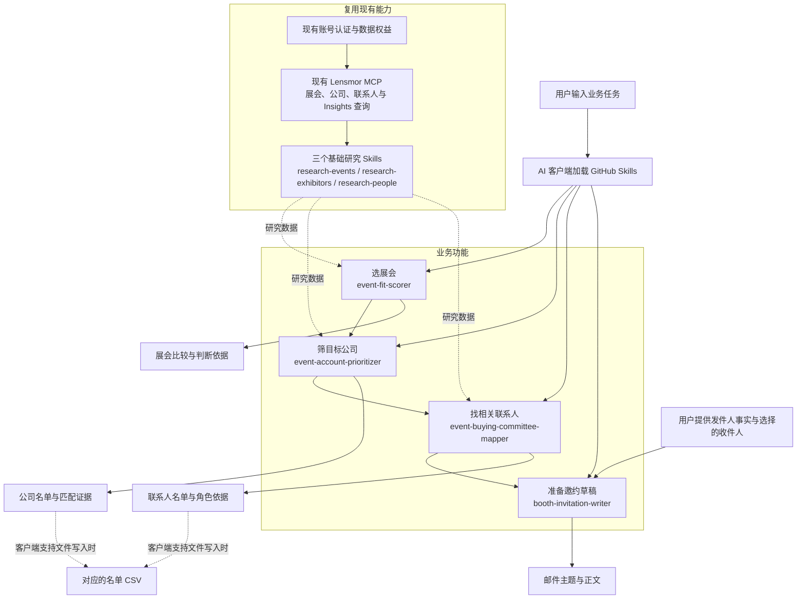

# Lensmor 展会 Skills 功能图

这张图展示本地候选的主要功能与复用关系。用户在支持 Skills 的 AI 客户端中提交任务，研究步骤通过现有 Lensmor MCP 获取数据，写作步骤使用已选中的研究结果和发件人资料。

四个业务节点之间的箭头表示可连续完成的步骤，也可以从已经具备输入的任一步开始。底部是这些研究功能共用的现有能力；草稿使用已交付的事实，不要求购买联系方式。

## 功能与输入输出

| 层次 | 功能 | 输入 | 输出 |
| --- | --- | --- | --- |
| 业务 | 选展会 | 产品、目标客户、地域、时间或指定届次 | 展会比较、匹配依据、信息缺口 |
| 业务 | 筛公司 | 指定展会、能力条件与明确限制 | 公司名单、证据、优先级理由 |
| 业务 | 找联系人 | 选中的公司与目标职能 | 姓名、职位、公司、管理层级、资料链接和角色依据 |
| 业务 | 写草稿 | 选定收件人、发件人身份与真实产品事实 | 邮件主题、正文与个性化依据 |
| 基础 | 展会研究 | 展会名称或搜索范围 | 届次识别、展会资料、实际可用的聚合 Insights |
| 基础 | 公司研究 | 展会范围、公司名称或能力条件 | 公司资料、参展商范围和能力证据 |
| 基础 | 人员研究 | 公司或展会范围、角色要求 | 可见联系人与字段可用性 |
| 开发 | 展商 CSV 导出 | 已确认的展会 ID、筛选条件、页数上限和 REST API key | 去重后的 CSV 与访问范围记录；也支持离线样例 |

默认安装脚本一次复制六个研究 Skills 和 `booth-invitation-writer`，共七个。其他原有规划、现场执行和展后跟进 Skills 仍保留，见[全部功能](../README.md#available-skills)。

## GitHub 与现有产品的关系

GitHub 负责让用户理解使用场景、看结果案例、获取 Skills 并在自己的客户端中复用。Lensmor MCP 提供真实数据访问；Lensmor Agent 是现有产品中的另一个业务入口，按自身发布版本运行。开源项目提供可复用脚本、Skills 工作流、案例和接入文档。

本图描述的候选范围为只读研究与草稿。账号登录、数据权益和客户端文件写入分别决定真实任务能完成到哪一步。后台 REST 的 0–10 分与 MCP Skill 的模型判断区别见[兼容说明](mcp-compatibility.md)。

操作步骤和可直接复制的提问见[中文使用指南](usage.zh-CN.md)，实际通过的验证见[验证记录](verification.md)。
