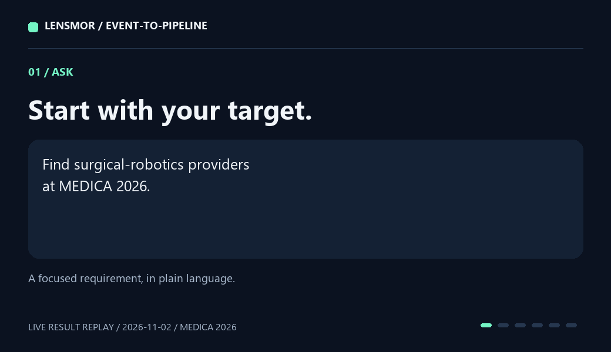

# Live example: surgical-robotics research at MEDICA 2026

**Selected account: Weisebot Co., Ltd.** Its returned company description explicitly identifies it as a surgical-robotics provider developing minimally invasive technology.

| Company | Location | Employee size | Matching evidence | Profile |
| --- | --- | --- | --- | --- |
| Weisebot Co., Ltd. | Hangzhou, China | 51–200 | The returned description states the complete surgical-robotics capability. | [Company LinkedIn](https://www.linkedin.com/company/weisebot) |

The event resolved to **MEDICA 2026, 16–19 November 2026, Messe Düsseldorf, Germany**. [Official event website](https://www.medica-tradefair.com/).



## Run it yourself

After [connecting Lensmor](../../integrations/mcp/README.md), ask:

```text
Use event-account-prioritizer to find surgical-robotics providers at
MEDICA 2026. Return a shortlist with evidence for each company's fit.
Use existing access and keep candidates that need review separate.
```

## Review queue

Two additional robotics candidates illustrate the distinction between a selected account and further research:

| Candidate | Returned product context | Next research step |
| --- | --- | --- |
| [ACCREA Medical Robotics](https://www.linkedin.com/company/accrea-medical-robotics) | Surgical and assistive robotic systems | Review the specific surgical product against the requested capability |
| [Agilis Robotics](https://www.linkedin.com/company/agilisrobotics) | Miniaturized robotic instruments for endoscopic surgery | Review the complete capability evidence |

Weisebot is selected for its explicit surgical-robotics offering. ACCREA and Agilis stay in the review queue for a closer look at the specific product requirement.

Company information is from Lensmor's records as of **2 November 2026**. This example uses preview access; the GIF replays the saved research result.

[Company data and research brief](result.json) · [Client setup](../../integrations/mcp/README.md) · [Offline examples](../README.md)
